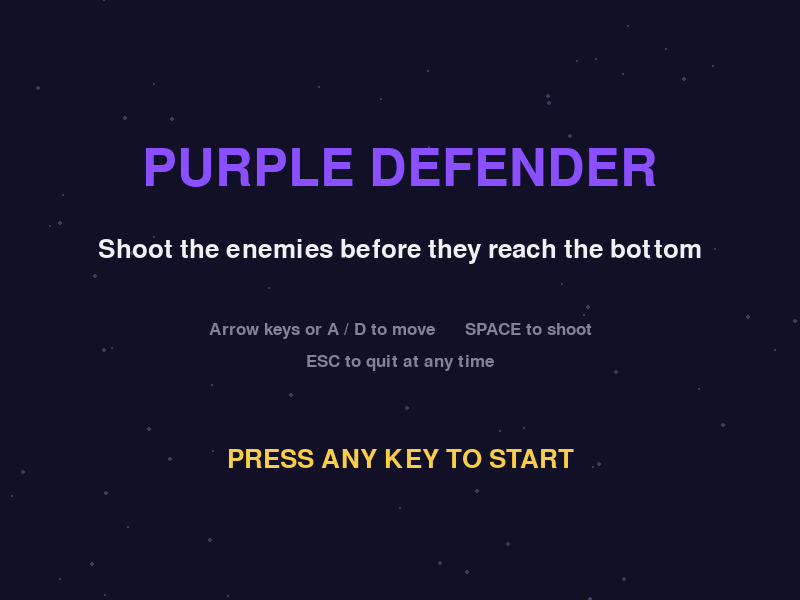

# Purple Defender

A small arcade game written in Python with [pygame], made for the first
assessment of the Robot Programming course at UC3M.

You control a purple ship at the bottom of the screen. Enemies fall from the
top on their own and you have to shoot them before they reach the ground. The
longer you survive, the faster and more frequent they get.



## Table of contents

- [Gameplay](#gameplay)
- [Requirements](#requirements)
- [Installation](#installation)
- [Running the game](#running-the-game)
- [Controls](#controls)
- [How the code is organised](#how-the-code-is-organised)
- [Repository structure](#repository-structure)
- [Authors](#authors)

## Gameplay

| Rule | Detail |
| --- | --- |
| Goal | Destroy as many enemies as possible |
| Points | 10 per enemy destroyed |
| Lives | 5 |
| Losing a life | Crashing into an enemy, or letting one reach the bottom |
| Game over | When all five lives are gone |
| Difficulty | Every 12 seconds the enemies get faster and appear more often |

The current score, the level and the remaining lives are shown at the top of
the screen while you play. The final score appears on the game over screen,
where you can start again or quit.

## Requirements

- Python 3.6 or newer
- pygame 2 (pygame 1.9 also works)

The game draws every sprite with code, so there are no images or sounds to
download: the single file `game.py` is the whole game.

## Installation

Clone the repository and switch to the `Game` branch:

```bash
git clone https://github.com/will-Cha/RP_Chalhoub_Perez-Lopez-Ceron_Rodriguez-Garcia-San-Miguel_25.git
cd RP_Chalhoub_Perez-Lopez-Ceron_Rodriguez-Garcia-San-Miguel_25
git checkout Game
```

Install pygame:

```bash
pip3 install pygame
```

<details>
<summary>On Ubuntu, if <code>pip3</code> is not installed</summary>

```bash
sudo apt update
sudo apt install python3-pip
pip3 install pygame
```

</details>

## Running the game

```bash
python3 game.py
```

A window of 800x600 pixels opens on the welcome screen. Press any key to
start.

## Controls

| Key | Action |
| --- | --- |
| Left / Right arrow, or A / D | Move the ship |
| Space | Shoot (hold to keep firing) |
| R | Play again, on the game over screen |
| Q | Quit, on the game over screen |
| Esc | Quit at any moment |

## How the code is organised

Everything lives in `game.py`, in four parts:

1. **Configuration** — screen size, colours, speeds, difficulty steps and
   scoring are all constants at the top of the file, so the game can be tuned
   without touching the logic.
2. **Sprites** — `Player`, `Bullet` and `Enemy`, each one a
   `pygame.sprite.Sprite` that knows how to draw and move itself.
3. **`Game`** — holds the state of the game (`welcome`, `playing` or
   `game_over`), the sprite groups, the score and the lives. Its `update`
   method runs the rules: spawning enemies, raising the difficulty, checking
   collisions and updating the score.
4. **The main loop** — `Game.run` reads the input, updates the state, draws
   the frame and calls `clock.tick(60)` so the game runs at a steady 60
   frames per second on any computer.

## Repository structure

```
RP_Chalhoub_Perez-Lopez-Ceron_Rodriguez-Garcia-San-Miguel_25
├── main      the default branch
├── Game      this branch: game.py and this README
└── ROS       for the ROS part of the course
```

## Authors

Group project for the Robot Programming course, UC3M.
Professor: Sofía Die-Pancorbo.

- Chalhoub, William
- Pérez-López Cerón, Pablo
- Rodríguez-García San Miguel, Jorge

[pygame]: https://www.pygame.org/
